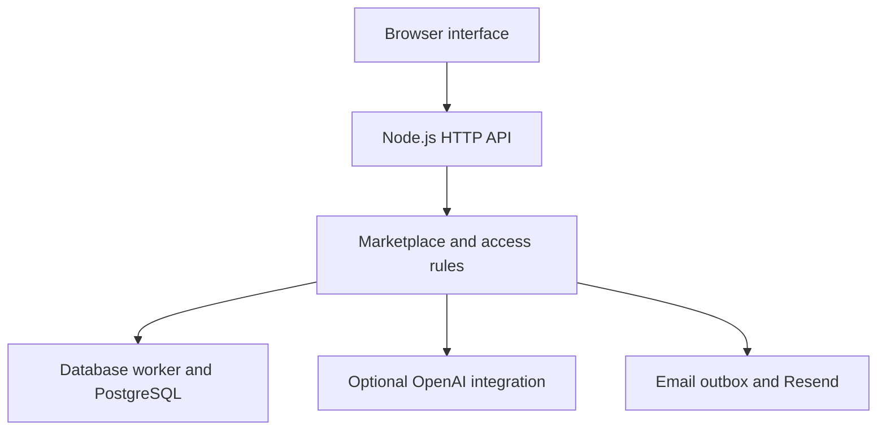

# Opyt Bez Opyta
### First work. Real experience. A portfolio that grows with every task.

**HRTech / Marketplace / AI** · The first product in an international student ecosystem

**Dmitrii Fedorenko** — Founder, CEO & Technical Lead  
**Sofia Shkop** — Co-founder & COO

Opyt Bez Opyta (Опыт без опыта — “Experience without experience”) is a student–business marketplace in development. Companies post paid, scoped tasks; students build practical experience, income opportunities, ratings and a portfolio of completed work.

This repository is the **public technical overview**. The application source code is proprietary and kept private.

## The problem
Students need experience to get their first job, but often cannot get that experience without a first opportunity. Businesses need help with specific tasks without running a full recruitment process.

## The product
A structured workflow connects a business task to a student deliverable: define the brief and acceptance criteria, review applications, select a student, submit work, request revisions, accept the result and leave a review. Completed tasks become portfolio entries.

## AI and the international ecosystem
AI is a core product direction: the platform includes integration code for submission review, support assistance and candidate analysis. These features use an external model API and remain subject to configuration, processing approval and quality validation. The marketplace also uses deterministic business rules and skills-based matching.

This marketplace is **stage one of a broader student ecosystem for international markets**. The long-term vision connects work opportunities, skills development and services for local and international students. The current release covers the first marketplace product; the wider ecosystem is on the roadmap.

## Founding team
| Founder | Role |
| --- | --- |
| Dmitrii Fedorenko | Founder, CEO & Technical Lead — software development, infrastructure, product and business leadership |
| Sofia Shkop | Co-founder & COO — operations and international development |

## International development
- Passed the first selection stage of a startup program in Dubai.
- Partnership agreed with **Xi’an Jiaotong-Liverpool University (XJTLU)**, with collaboration planned after establishing the platform in Primorsky Krai.

## My engineering role
I develop the platform software and manage its technical infrastructure. My work covers the browser interface, backend routes and business rules, database integration, external-service integrations, testing and deployment configuration.

The technical details below were checked against the RC3.7 source snapshot on 12 November 2026. They describe the code in that snapshot; they do not certify what is currently deployed.

## Technology stack
| Layer | Verified implementation |
| --- | --- |
| Frontend | Vanilla JavaScript, HTML and CSS; no frontend framework in the reviewed build |
| Backend | JavaScript on Node.js 22; built-in HTTP server and explicit API routing |
| Database | PostgreSQL via the pg driver; SQL schema initialization and incremental changes |
| Database adapter | Worker thread with MessageChannel and a synchronous query bridge |
| AI integration | Server-side OpenAI API calls; configuration and processing-approval gates |
| Email integration | Resend API, database outbox and signed delivery webhooks |
| Packaging | Docker and Docker Compose; non-root app container and health checks |
| Local verification | Node.js tests, static contracts, HTTP integration tests and PGlite test database |

## Architecture
The current application is a **modular monolith**: one Node.js process serves the frontend and API, with domain modules for marketplace workflows, subscriptions, company workspaces, email and commerce policy.

Student, business and administrator roles control access to the workflows. The database stores tasks, applications, submissions, reviews, subscriptions and operational events. External service credentials are supplied through server environment variables.

The synchronous database bridge keeps the current code simple but serializes database work. Load testing and database-access improvements are part of the engineering roadmap.

## Features present in the reviewed code
| Area | Implemented scope |
| --- | --- |
| Accounts | Student and business registration, education and skill profiles, email-verification flow |
| Marketplace | Task briefs, deadlines, moderation, applications, selection and task status transitions |
| Delivery | Text, links and supported file attachments; revisions, acceptance and dispute records |
| Reputation | Mutual reviews, completed-task portfolio, achievements and opt-in leaderboard |
| Planning | Calendar endpoints and deadline reminders |
| Matching | Rules based on skills, location and work format; optional AI-assisted explanations |
| Business tools | Company workspace roles, invitations and bulk task publishing |
| Subscriptions | FREE / PRO / PRO+ catalog and server-side feature gates |
| Operations | Admin tools, audit events, rate limiting and integration-readiness checks |

Presence in code does not mean every workflow has passed production acceptance testing.

## Current status — test release / pre-launch
**RC3.7 is a release candidate for isolated testing, not a production-ready payments platform.**

- Real task funding, escrow/holds, payouts and refunds are not connected to a verified financial-provider workflow. Internal deal-intent records are not bank-held funds.
- Subscription checkout requires external end-to-end validation before activation.
- AI review and assistance require configuration and approval for external data processing. Quality, privacy and cost validation remain open; unavailable or uncertain reviews fall back to manual review.
- Email code includes retries and delivery-event handling. Live delivery and webhook configuration still require validation.
- The syntax checks and the first ten test stages passed during the source review. The final local HTTP integration stage failed on a task-application request (expected 201, received 409). The full suite is **not green**; diagnosis and a complete rerun remain open.
- A real PostgreSQL staging run and verification of the deployed build remain necessary.

## Project environment
**Test deployment:** https://test.opytbezopyta.ru

This is a testing environment, not a promise of unrestricted public demo access. Access may be restricted; credentials and private user data are never published here.

## Roadmap
- [ ] Diagnose the failing application-flow integration test and pass the complete suite.
- [ ] Validate the release against real PostgreSQL in an isolated staging environment.
- [ ] Complete student and company workflow acceptance testing on mobile and desktop.
- [ ] Validate transactional email delivery, webhook signatures and retries end to end.
- [ ] Evaluate AI output quality, privacy, failure handling and spending limits.
- [ ] Integrate and test the agreed financial-provider workflow before enabling real payments.
- [ ] Run a limited pilot, measure completion and repeat usage, and improve reliability.
- [ ] Test concurrency and load; improve the database-access path as needed.
- [ ] Expand the marketplace and explore international student services after pilot validation.

## Repository boundaries
Only reviewed project documentation belongs in this public repository. No application source, deployment secrets, database exports, customer records or private access instructions are included. Interface screenshots will be added only after review with synthetic or anonymized data.

**Founder:** [Dmitrii Fedorenko](https://github.com/dmitrii-fedorenko) · **Project:** Opyt Bez Opyta
